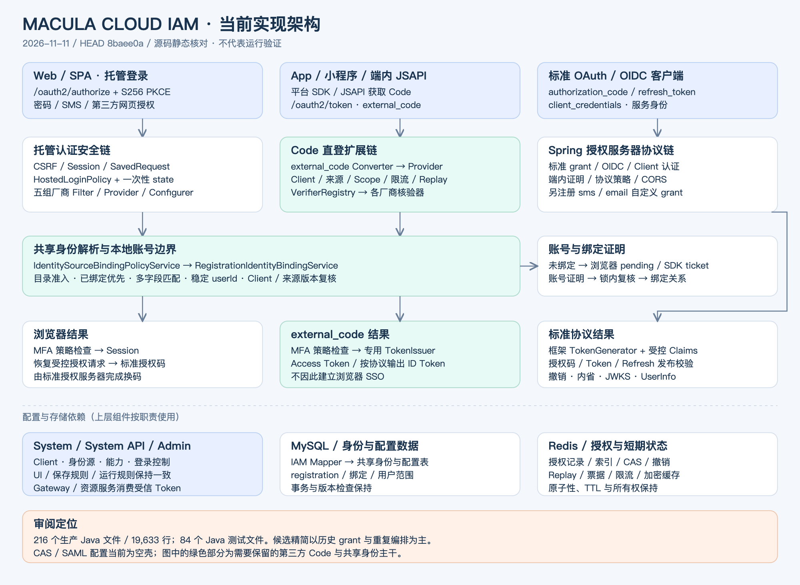
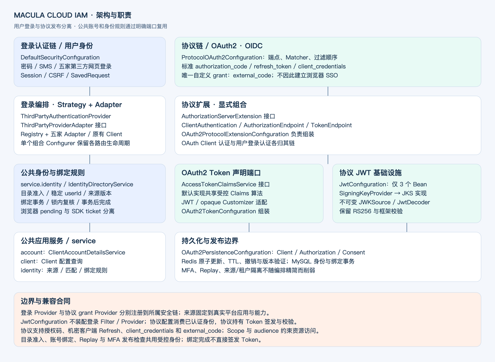

# Macula Cloud IAM 架构与简化审阅

日期：2026-11-11。源码基线：`macula-cloud`，HEAD `8baee0a`，审阅开始时工作区干净。

本报告第 2—4 节保留初始源码基线的审阅证据与候选分析，不能当作重构后现状。方案已获确认并完成本地实现；实施后结构见第 5 节，实际验证见 [verification.md](verification.md)。未进行真实厂商联调、业务库迁移、镜像或远端更新。

## 1. 结论与用户确认范围

IAM 的主干可以保留：Spring Security 负责认证链，授权服务器负责协议，第三方适配器负责核验平台身份，共用绑定策略解析 IAM 用户。主要维护成本来自历史 grant 遗留、重复的厂商编排和持续叠加的兼容分支。建议渐进收敛，避免整体重写。

用户已澄清：**保留 `urn:macula:params:oauth:grant-type:external_code`，删除其他自定义 grant**。据当前实现，目标删除 `sms`、`email` 的 Token 扩展，并清理已停用的 `password` grant 源码。保留现有标准 `authorization_code`、`refresh_token`、`client_credentials`；不因此启用其他标准 grant。

“保持功能”以未被用户明确删除的功能为边界：保留托管页密码/SMS 登录、第三方网页登录、SDK/小程序/JSAPI Code 登录、绑定及账号证明、OIDC、撤销/内省、来源与租户隔离。短信/邮箱直接兑换 Token 的调用合同会退出，不能同时承诺这两条旧接口行为不变。邮箱登录目前主要在待删除的协议扩展链，不应借此次重构擅自新增托管页邮箱登录。

## 2. 重构前架构（HEAD 8baee0a）



[可编辑 SVG](architecture-current.svg)。Java 生产源码 216 个文件、19,633 行；Java 测试源码 84 个文件。统计包含版权头、注释、空行和 package-info，不是可执行语句数。

| 层次 | 当前组件与职责 |
| --- | --- |
| 接入层 | Web/SPA 走 `/oauth2/authorize`；托管页接收密码、SMS 和第三方回调；SDK/小程序/端内 JSAPI 走 Token 端点 `external_code` |
| 协议安全链 | `ProtocolOAuth2Configuration` 安装最高优先级安全链，配置标准授权、三个已注册扩展、OIDC、内省、CORS 与失败响应 |
| 托管认证链 | `DefaultSecurityConfiguration` 安装后续安全链，启用 CSRF、受控 RequestCache、密码/SMS、五家第三方网页登录与绑定页面 |
| 身份核验 | `AbstractThirdPartyAuthenticationFilter` 管理浏览器 state/续转；各厂商 Client 处理外部协议；`ExternalCodeVerifierRegistry` 分派非浏览器平台 Code |
| 本地身份 | 浏览器 `ThirdPartyIdentityResolutionService` 和 Code `ExternalCodeAccountResolver` 共用 `IdentitySourceBindingPolicyService`；目录准入、绑定映射、稳定用户 ID 关系与账号范围校验在此汇聚 |
| 结果发布 | 浏览器成功建立会话后恢复授权请求；标准授权由框架签发；`external_code` 经 `OAuth2UserGrantTokenIssuer` 签发；`MfaCompletionService` 在各发布点执行策略 |
| 持久化 | IAM 自有 Mapper 读取共享身份/Client/用户配置；Redis 保存授权、索引、防重放、票据、缓存与限流；System/Admin 管理配置和前端契约；`UserAuthInfoService` 是可选用户目录扩展点 |
| 资源使用 | Gateway/资源服务使用 IAM Token，并参与受信声明、权限和内省契约；本轮未开展 Gateway 全量审计 |

两条第三方路径复用身份策略，但保留不同的协议结果：网页核验后可以建立 SSO 会话，直接 Code 不因此建立浏览器 SSO。不可为了减少类数量把二者混成一个“登录成功就发 Token”的通用 Controller。

重构前源码锚点（均指 HEAD 8baee0a，相对仓库根目录；行号不适用于当前工作区）：

- `macula-cloud-iam/src/main/java/dev/macula/cloud/iam/config/ProtocolOAuth2Configuration.java:119`：协议链；`:193` 附近注册 SMS、email、external_code。
- `macula-cloud-iam/src/main/java/dev/macula/cloud/iam/config/DefaultSecurityConfiguration.java:107`：托管认证链；`:146` 起密码、SMS 与厂商装配。
- `macula-cloud-iam/src/main/java/dev/macula/cloud/iam/authentication/thirdparty/IdentitySourceBindingPolicyService.java:58`：共同身份策略。
- `macula-cloud-iam/src/main/java/dev/macula/cloud/iam/protocol/oauth2/grant/externalcode/OAuth2ExternalCodeAuthenticationProvider.java:72`：Client → 来源/Scope → 限流 → 占用 → 核验 → 账号 → 签发。
- `macula-cloud-iam/src/main/java/dev/macula/cloud/iam/service/oauth2/MaculaOAuth2AuthorizationService.java:196`：授权存储与版本校验；`:371`：旧格式读取兼容。

## 3. 冗余与优化优先级

### P1：删除无用 grant 及失去用途的继承体系

**证据**：`ProtocolOAuth2Configuration` 只注册 SMS、email、external_code 自定义 Converter/Provider；password 类仍存在但不再装配。`IamProtocolTest` 已有 `removedPasswordGrantIsRejectedForPublicAndConfidentialClients`。

第一批删除候选：

- `protocol/oauth2/grant/password/`：4 个 Java 文件，230 行，含 package-info。
- `protocol/oauth2/grant/sms/`：4 个 Java 文件，234 行，含 package-info。
- `protocol/oauth2/grant/email/`：4 个 Java 文件，224 行，含 package-info。
- `grant/base/` 中 `OAuth2ResourceOwnerBaseAuthenticationProvider`、`OAuth2ResourceOwnerBaseAuthenticationConverter`、`OAuth2ResourceOwnerBaseAuthenticationToken`：3 个文件、366 行。

合计 **15 个 Java 文件、1,054 行，约占 IAM 生产源码总行数 5.4%**，是静态删除候选，尚未扣除替代代码，也不构成最终净减量承诺。

**保留** `OAuth2UserGrantTokenIssuer`：external_code 正在使用。可将其移到 grant 公共目录，或在只剩一个调用方时命名为 `ExternalCodeTokenIssuer`，不要为保留原包结构留下无用途的抽象基类。

额外候选 `CompatibilityRefreshTokenAuthenticationProvider`（141 行）：生产 Java 引用仅见自身声明/构造器，当前配置没有装配。它包含 password/sms 兼容刷新逻辑。删除前还需核对外部自定义装配及完整启动测试；不能宣称当前线上正运行此路径。

### P1：删除必须贯穿配置、发码、绑定与调用示例

只删除 Converter 会留下“管理端可以保存，但服务端无法执行”的配置。至少同步检查：

| 位置 | 需要收敛的内容 |
| --- | --- |
| IAM `ProtocolOAuth2Configuration` | 删除 SMS/email Token Converter、Provider 和失去用途的注入；保留托管链 `SmsAuthenticationProvider` |
| IAM `PublicTokenClientAuthenticationConverter:48` | 当前仍接受 password/sms/email/external_code/refresh 的受限 public-client 提取；去掉已删除项，核对 refresh 原有拒绝语义 |
| IAM `ProtocolVerificationCodeController:60` | `/api/v1/oauth2/sms-codes`、`email-codes` 以及配套 captcha 专为直接 grant 服务，退出其失去用途的接口；区分托管 `/api/v1/sms-code` 和绑定发码接口 |
| IAM `ExternalIdentityBindingService:56` | 账号证明 Token 白名单当前为 authorization_code、sms、email；删除后应保留授权码证明路径，不能误删绑定本身，也不能未经安全论证让待绑定外部 Code 证明本地账号归属 |
| IAM 协议策略/CORS/失败处理 | 删除 SMS/email 专属白名单、响应和校验分支；保留 external_code 与公共认证规则 |
| System API `OAuth2ProtocolConfiguration:38` | grant 白名单、协议与用户能力约束 |
| System `OAuth2ClientConfigServiceImpl:87` | 保存与更新校验、登录范围、启用规则 |
| System `OAuth2ClientConfigurationCatalogServiceImpl:67` | Scope 的可用 grant 目录 |
| Admin | grant 选项、模型默认值、依赖规则、示例、复制内容及相关测试 |
| README/接入说明/迁移材料 | 描述新的可配置范围与旧调用方整改路径，不以追加新段落保留互相矛盾的现行说明 |

现有配置不能静默删改，也不能把旧 `sms`/`email` 请求改写成 `external_code`。建议先列出受影响 Client；通过管理端明确整改，或增加经批准的迁移材料。历史已签发 Token 的有效期、刷新与撤销语义属于待确认的兼容合同，不能通过“删除扩展”推断为全部失效。

注意：`email` 同时也是标准 OIDC Scope/资料字段，`password` 也用于托管密码认证，`sms` 也用于账号证明及通知。禁止全仓按字符串删除。

### P2：用策略模式收敛第三方重复编排

**证据**：`GithubAuthenticationProvider` 与 `FeishuAuthenticationProvider` 等均执行：判断厂商 → 读取固定来源 → Client 核验 → 公共身份解析 → 构造 `ThirdPartyAuthenticationToken`。五个 `*LoginFilterConfigurer` 又重复读取 Bean、配置 Filter、注册 Provider 与设置过滤顺序。`AbstractThirdPartyAuthenticationFilter` 已经承担公共 state/RequestCache 模板。

建议在现有抽象上补齐统一 `ThirdPartyAuthenticationProvider`，按稳定厂商/能力键选择适配器。适配器只负责构建厂商授权 URL 和核验凭证，返回 `VerifiedExternalIdentity`。可保留极薄的路由 Filter 与显式 matcher，先消除 Provider/Configurer 的编排重复，避免一次替换所有安全过滤器。

模式：**Strategy + Adapter + Registry**。不要再引入 AbstractFactory、反射路由或一层层没有行为的 Manager。不同厂商的 Token 字段、PKCE、目录接口、企业身份域不同，应继续分别实现。注册表应拒绝重复键、未知能力和未启用来源。

### P2：消除为了单测而存在的生产旁路

**证据**：`IdentitySourceBindingPolicyService` 有不传目录服务的构造器，运行代码判断 `directory == null`；`ThirdPartyBindingService`、`ExternalIdentityBindingService` 存在 `transactions == null`/`directory == null` 分支；external_code Provider 有不装配来源/限流的构造器。

目前生产构造器显式注入依赖，这不是已证实的生产漏洞。但测试路径与生产路径分叉，容易让测试覆盖较弱版本而遗漏目录、限流或事务约束。

建议生产类只接受完整的必要依赖；纯逻辑测试使用 Mock，事务测试使用适当的事务管理器；真正业务允许的可选能力用显式策略表达。NoOp MFA 是当前声明的扩展语义，可保留；目录准入、来源校验和限流不能统一变成默认 NoOp。

### P2：拆分职责集中的配置与存储组件

`ProtocolOAuth2Configuration` 379 行：同一方法同时装配 Client 认证、授权校验、grant、内省、CORS、MFA、resource-server 与授权恢复。建议按已有协议职责抽出少量装配方法或配置器：标准端点、external_code、Client 认证；主链继续清楚展示 matcher 与过滤顺序。无须把每个 Bean 拆成独立配置类。

`MaculaOAuth2AuthorizationService` 594 行：同时处理实体转换、JSON、索引、TTL、Lua CAS、旧格式兼容及版本校验。候选拆分为原 `OAuth2AuthorizationService` 门面、`AuthorizationRecordCodec` 和 Redis 存储组件。**保留 Lua 原子性、版本条件、删除墓碑、索引一致性与撤销语义**；只有观测证明旧格式已退出后才删除 fallback。

模式：**Facade + Repository/Codec**，只对确有独立变化原因的职责拆分。避免增加只转发一次调用的接口。

### P3：清理没有业务调用的遗留类与误导性说明

- `ThirdPartyUserDetailsService`（60 行）生产引用仅见自身声明；测试仍直接实例化/导入。它按全局 username 加载用户，当前认证主线已改用受控 Client/来源策略。核对装配及外部扩展后可清理，避免后续误用成旁路。
- `SysUserIdentityBindingMapper` 生产 Java 引用仅自身；对应旧 Entity 与若干测试 Mock 可以列入清理候选，但必须核对 MyBatis/XML/外部引用。**删除 Java 映射不等于允许删除历史表和数据。**
- `ProtocolCasConfiguration`、`ProtocolSaml2Configuration` 各 30 行，均为空 `@Configuration`。可删除空壳，能力文档按“未实现”标示；不能按历史文档宣传 CAS/SAML 已具备认证能力。
- README 已连续叠加多个日期的变更说明，包含被后文替代的旧说明。把“当前使用说明”与“迁移历史”分开，当前合同只维护一份。
- `CustomeOAuth2AccessTokenGenerator` 命名有拼写问题；如确实属于内部实现，可在相关重构时更正，不为命名单独扩大风险面。

## 4. 不应作为冗余删除的内容

1. UI/System 保存校验与 IAM 执行校验：边界不同。共享纯规则以防漂移，但运行时不能信任管理端已经检查。
2. 来源 registration、能力、version 与 Client authorizationVersion：防止密钥轮换、撤销及配置切换后的陈旧身份继续使用。
3. 网页 state/RequestCache 与 Code ReplayStore：分别保护不同流程，不能用一个替代另一个。
4. Code 的 NOT_SUBMITTED / UNKNOWN / CONSUMED：只有明确未提交才允许释放占用；统一 catch 后 release 会引入重放风险。
5. 浏览器 pending 与 SDK binding ticket：都可复用账号证明逻辑，但 CSRF、会话、所有权、TTL 和发布结果不同。
6. MFA 发布边界、Redis 原子更新、锁 owner、事务后完成票据：保留这些不变量，再优化表达。

## 5. 实施后结构与设计模式



[可编辑 SVG](architecture-target.svg)。关键边界：**用户登录认证配置与 OAuth2/OIDC 协议配置独立**。

| 装配入口 | 负责 | 接口与实现 |
| --- | --- | --- |
| DefaultSecurityConfiguration | 用户密码/SMS/第三方网页登录、Session、CSRF、受控请求恢复 | ThirdPartyProviderAdapter + Registry + 五家 Adapter，统一 Provider，组合 Configurer |
| ProtocolOAuth2Configuration | 协议端点、安全链与过滤顺序，消费已认证用户身份 | AuthorizationServerExtension 的 ClientAuthentication、AuthorizationEndpoint、TokenEndpoint 三个实现 |
| OAuth2TokenConfiguration | TokenGenerator、JWT/opaque Claims 适配 | AccessTokenClaimsService + 默认应用服务 |
| JwtConfiguration | 签名密钥、不可变 JWKSource、JwtDecoder 三个 Bean | SigningKeyProvider + KeyStoreSigningKeyProvider；框架 JwtDecoder 接口 |
| OAuth2PersistenceConfiguration | Client、Authorization、Consent 持久化装配 | 原框架 Repository/Service 接口，保留原子性与版本校验 |

JwtConfiguration 的实现与密钥属性放在 protocol/oauth2/jwt；它不注册登录 Provider、Filter 或认证方式。OAuth Client 认证属于协议扩展，与用户登录认证分开。登录 Provider 和 external_code Provider 分别在各自链内注册，避免全局 AuthenticationProvider Bean 自动发现造成交叉装配。

协议服务 DefaultAccessTokenClaimsService 共用 JWT/opaque 的受控声明规则，协议 Customizer 负责框架上下文适配。跨登录与协议的账号、Client和身份绑定服务独立归 service.account/client/identity；IdentityDirectoryService 隔离公共身份规则与具体目录实现。密钥来源用 Strategy，平台差异用 Adapter + Registry，授权端点用显式组合。没有为了降低配置类行数把算法藏进匿名 Bean，也没有把所有厂商凭据和流程压进通用 Map。

最终 IAM 生产 Java 为 **216 文件、18,052 行**。其中具名功能类型文件为 **199 个**，初始为 211 个，净减 12 个；新增 package-info 用于解释职责与兼容边界。总行数相对初始 19,633 行下降约 8.1%，统计包括版权头、注释和空行，新增接口、兼容适配与包说明已计入；测试、图和文档不计入。

当前包结构按职责划分：

```text
authentication/
  userdetails/              # HostedUserDetailsService：请求型Spring登录适配
  sms/                      # 手机验证码认证接口与实现
  thirdparty/
    browser/                # Filter模板、Provider、组合Configurer、state端口
    provider/               # 五家平台适配契约与注册表
    binding/                # 浏览器pending绑定编排
    directory/              # IdentityDirectoryService的平台实现与刷新设施
    cache/                  # 平台应用Token加密缓存
    <兼容身份/状态类型>       # 保持现存Session/授权类型名
protocol/oauth2/
  persistence/              # RegisteredClient / Authorization / Consent
  token/claims/             # 协议Claims端口与默认实现
  profile/                  # OAuth2受保护资料端点
  binding/                  # 授权码证明的Token绑定端点
  endpoint/                 # 协议参数与错误码
  jwt/                      # JWK / decoder / signing key
  configuration/            # Client / Authorization / Token端点扩展
  grant/externalcode/       # 唯一自定义grant
service/
  account/                  # 账号、目录与显式Client主体加载端口
  client/                   # 共享Client配置查询
  identity/                 # 公共身份规则与目录准入端口
  userdetails/              # 仅保留原SysUserDetails序列化类型
```

不按名称包含OAuth2就移动：Client配置也是托管登录策略输入。反之，Claims虽为两种Token复用，仍解释RegisteredClient/grant/Scope，应归协议。`OAuth2ErrorCodesExpand` 常量接口已改为协议包的 `OAuth2ExtensionErrorCodes` final类；端点工具删除无调用包装方法。

MaculaOAuth2AuthorizationService 本轮保留原 Redis 存储算法，只补入受限历史 Principal 读取适配；未扩大为全面持久化重写。具体实施偏差与理由见 [build-notes.md](build-notes.md)。

## 6. 建议实施批次与验收

以下保留最初的实施与验收建议。实际工程合同为已接受的 [plan.md](plan.md)，运行结果以 [verification.md](verification.md) 为准。

1. 扩展收敛：退出 SMS/email Token grant，清理 password 及无用途基类；同步 API/System/Admin/文档与旧配置处置。先形成可独立回归的变更。
2. 第三方编排收敛：以一个通用 Provider 和注册表替代重复编排，保留厂商 Client 与已有 state/能力/绑定合同。
3. 可维护性整理：消除测试旁路、清理未使用类；有独立收益时再拆授权存储，不与 grant 删除一起重写全部持久化。

最低验收矩阵：

| 领域 | 需要证明的行为 |
| --- | --- |
| grant 退出 | sms/email/password 无法兑换新 Token；受支持 Client 返回明确的协议错误；重复/畸形参数拒绝且没有发码、验证码消费或第三方请求副作用 |
| 标准协议 | 授权码+S256、OIDC ID Token/UserInfo、机密 Client 刷新、client_credentials、内省与撤销继续工作 |
| 托管登录 | 密码、SMS、CSRF、原始授权请求恢复、当前 Client 方法开关保持 |
| external_code | 已绑定、自动绑定、待绑定与完成绑定；无浏览器 SSO；Scope/nonce、固定来源、重放、限流、不同能力及异常消费状态保持 |
| 安全状态变化 | 来源停用/轮换、Client 版本变化、目录拒绝、MFA 拒绝不能发布新结果；跨租户/来源不得串号 |
| 配置与前端 | 仅显示标准 grant 与 external_code；旧配置可识别并整改；指南只生成可执行合同 |
| 外部环境 | 真 Redis/MySQL 并发与事务独立验证；厂商及真机验证单独记录，Mock 不能替代 |

建议后续命令：`mvn -pl macula-cloud-iam -am test -Plocal`；涉及 System/API 后运行对应组合，再按跨服务风险扩大。Admin 运行目标 Vitest 与构建，页面关键改动再跑目标 Cypress。不能把这些尚未执行的命令当作绿色验证。

## 7. 证据与限制

初始静态审阅包括 POM/README、安全链、身份/绑定、grant、Client 提取、存储、配置目录、Admin 及测试引用核对。实施阶段已执行 Maven、管理端单元与浏览器回归、Checkstyle，以及隔离 MySQL/Redis 集成测试；命令、结果和证据边界见 [verification.md](verification.md)。

未执行真实厂商 Code/真机联调、业务库迁移、部署或 SLO 观测。本地 Mock 与隔离基础设施测试不能替代这些验证。
