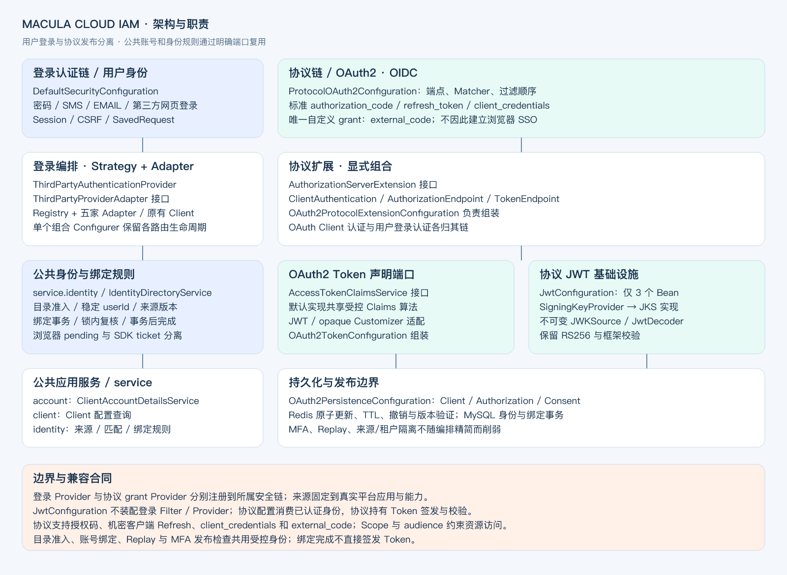

# Macula Cloud IAM

Macula Cloud IAM 是平台的身份认证与授权中心，为浏览器、移动应用、小程序和后端服务提供统一的登录及令牌服务。它基于 Spring
Security 和 Spring Authorization Server，支持 OAuth 2.1 与 OpenID Connect，并将第三方身份映射为受控的本地账号。

Web/SPA在创建时选择`webLoginMode=BROWSER|IN_APP`，创建成功后固定，草稿也不可修改。BROWSER使用普通登录与SSO；IN_APP固定一个平台能力并核验平台证明，不提供普通登录回退。Web保持服务端机密认证，SPA保持none。独立IN_APP应用类型已移除，不兼容或迁移旧记录。

## 能力

- **统一登录**：账号密码、短信/邮箱验证码及 GitHub、企业微信、飞书、钉钉、微信登录，支持浏览器 SSO。
- **标准授权**：授权码 + S256 PKCE、机密客户端刷新、`client_credentials`；OIDC 提供 ID Token、Discovery、UserInfo 与退出端点。
- **平台 Code 登录**：移动 SDK、小程序和端内 JSAPI 通过 `external_code` 接入，保持平台应用、来源与能力隔离。
- **身份绑定**：已绑定账号优先；可按可信属性匹配本地账号，也可通过密码、绑定短信或合格会话证明账号归属。
- **令牌管理**：JWT / reference Access Token、内省、撤销、Scope 与资源 audience 校验，以及 Client/身份源版本约束。
- **扩展能力**：可替换的用户目录、平台适配、签名密钥来源及 MFA 发布策略。默认 MFA 策略不增加因子要求。

## 组件与依赖

| 项目       | 说明                                                                                                    |
|------------|---------------------------------------------------------------------------------------------------------|
| Maven 坐标 | `dev.macula.cloud:macula-cloud-iam:${revision}`                                                         |
| 运行方式   | 独立部署的 Spring Boot 服务，默认端口 `9010`                                                            |
| 平台依赖   | System 管理账号、Client、Scope 与身份源；Admin 提供管理界面                                             |
| 基础设施   | MySQL 保存身份与配置，Redis 保存授权及短期安全状态，Nacos 提供共享环境配置                              |
| 主要依赖   | `macula-cloud-system-api`、Spring Authorization Server、Macula Boot Web/Cache/MyBatis/Crypto、Thymeleaf |

业务应用通过 HTTP 协议接入 IAM；资源服务使用平台安全组件验证访问令牌。IAM 模块本身作为服务构建运行，无需作为业务应用的
Maven 依赖引入。

## 架构



[查看可编辑 SVG](docs/architecture.svg) · [类图与整体架构逻辑](docs/architecture.md)。IAM 将用户登录、协议发布和公共身份规则分开：

| 层次         | 职责                                                            | 代码入口                                                                                                    |
|--------------|-----------------------------------------------------------------|-------------------------------------------------------------------------------------------------------------|
| 登录认证     | 用户认证、浏览器 state、Session、CSRF 与登录请求恢复            | `authentication`、`DefaultSecurityConfiguration`                                                            |
| 协议         | OAuth2/OIDC 端点、Client 认证、grant、授权存储、Token 与 Claims | `protocol/oauth2`、`ProtocolOAuth2Configuration`                                                            |
| 公共应用服务 | 账号目录、应用快照、身份源及绑定规则                         | `service/account`、`service/application`、`service/identity`                                                     |
| 装配         | 按职责组合安全链与基础设施                                      | `config/DefaultSecurityConfiguration` 为登录装配，`config/oauth2` 为协议装配；根包保留共用 MFA 与密码编码器 |

网页登录认证后建立会话，再由协议链完成授权；直接平台 Code 登录只返回协议结果，不建立浏览器 SSO。两条路径共用身份解析、目录准入和绑定规则。

短信与邮箱共用 `VerificationCodeChannelService` 服务端口和 Filter/Provider 认证模板，分别保留通道适配及账号目录接口。缺少验证码内核或投递器时统一失败关闭；登录和身份绑定按可信 Client、通道与用途隔离。验证码 Token 的持久化类型保持兼容。

## 应用与协议模型

应用公共信息、单协议登记、身份源关联分别保存在`sys_iam_application`、`sys_iam_application_protocol_config`和`sys_iam_application_identity_provider`。协议凭据只属于登记，不进入公共应用快照。一个应用单选协议，当前可选OIDC或OAuth2.1；新增SAML2/CAS需实现独立策略及发布适配器。

登录层通过`LoginApplicationResolver`取得受信应用，公共账号服务按内部应用ID加载目录；OAuth适配器负责解析受控授权请求并发布`RegisteredClient`，保留原公开Client ID和凭据哈希。来源绑定使用`sys_identity_provider_user_binding`，旧`sys_user_identity_binding`已退役，由V28删除；升级前归档其历史记录。

V27需要IAM与System协同升级，旧版本不能混跑新结构；预检与失败恢复要求见[配置指南](docs/configuration.md)。配置缓存使用v7，授权和Session序列化合同保持。

## 接入方式

先在 System/Admin 创建应用，选择应用类型和协议，配置客户端认证、Scope、回调地址、Origin 与具体身份源，完成校验后启用。

| 场景              | 推荐入口                                            | 关键约束                                   |
|-------------------|-----------------------------------------------------|--------------------------------------------|
| Web / SPA         | `/oauth2/authorize` → IAM 登录 → 授权码换 Token     | S256 PKCE、精确回调；SPA 使用 `none`       |
| 移动应用 / 小程序 | 平台 SDK Code → `/oauth2/token`，或系统浏览器授权码 | 固定来源与认证能力；内置登录入口需独立启用 |
| Web/SPA端内模式          | 企业微信/微信网页授权，或飞书/钉钉 JSAPI Code       | 只在配置的容器与能力下使用                 |
| 后端服务          | `/oauth2/token` + `client_credentials`              | 机密客户端、业务 Scope；不代表用户身份     |

### 浏览器授权码

以下是 OIDC 授权请求；应用自行生成并保存随机 `state`、`nonce` 及 PKCE verifier：

```http
GET /oauth2/authorize?response_type=code
    &client_id=<client_id>
    &redirect_uri=<registered_redirect_uri>
    &scope=openid%20profile
    &state=<random_state>
    &nonce=<random_nonce>
    &code_challenge=<s256_challenge>
    &code_challenge_method=S256
```

回调校验 `state` 后，通过 Token 端点提交授权码和原 verifier。公共客户端示例：

```bash
curl --request POST "$IAM_ISSUER_URI/oauth2/token" \
  --data-urlencode 'grant_type=authorization_code' \
  --data-urlencode 'client_id=<client_id>' \
  --data-urlencode 'code=<authorization_code>' \
  --data-urlencode 'redirect_uri=<registered_redirect_uri>' \
  --data-urlencode 'code_verifier=<original_verifier>'
```

OIDC 接入方须验证 ID Token 签名、issuer、audience、有效期及请求中的 nonce。访问 API 使用 Access Token。纯 OAuth2.1 应用不请求
`openid`，也不接收 ID Token。

### 平台 Code

唯一自定义 grant 为 `urn:macula:params:oauth:grant-type:external_code`。应用通过受信平台 SDK 取得 Code，提交 Code
类型及该能力要求的参数；IAM 按当前 Client 固定的来源核验身份。

未绑定时返回 `binding_required` 与短期绑定入口。完成账号证明后，应用重新取得平台 Code 登录；绑定完成本身不签发
Token。各平台参数、终端能力与示例见[第三方接入说明](docs/third-party-integration.md)。

公共客户端不支持 `client_credentials` 或 Refresh Token。`password`、`sms`、`email` grant 不提供 Token 兑换；密码、短信与邮箱作为
IAM 托管认证方式，通过授权码流程完成授权。

## 常用端点

协议端点地址以相应协议的 Discovery 为准；托管登录端点由 IAM 固定提供：

| 端点                                      | 用途                                                |
|-------------------------------------------|-----------------------------------------------------|
| `/login`                                  | IAM 登录页及密码认证                                |
| `/login/sms`、`/login/email`              | POST 托管验证码认证，受 CSRF 与 Client 策略约束     |
| `/api/v1/sms-code`、`/api/v1/email-code`  | POST 发送相应登录验证码                             |
| `/oauth2/authorize`                       | 授权码入口                                          |
| `/oauth2/token`                           | 获取或刷新令牌                                      |
| `/oauth2/introspect`、`/oauth2/revoke`    | 内省与撤销                                          |
| `/.well-known/openid-configuration`       | OIDC Discovery                                      |
| `/.well-known/oauth-authorization-server` | OAuth2 授权服务器元数据；带 issuer 路径时按规范定位 |
| `/oauth2/jwks`                            | IAM 签名公钥                                        |
| `/userinfo`、`/connect/logout`            | OIDC 用户信息与退出                                 |
| `/api/v1/profile`                         | 具有 `profile` Scope 与对应 audience 的平台用户资料 |

## 本地运行

1. 按[根 README](../README.md)准备 Java 17、Macula Boot 构件、MySQL、Redis、Nacos 与 System 数据库。
2. 通过环境变量或配置中心提供加密、审计及签名配置。
3. 在 IDE 运行 `MaculaIamApplication`，使用 `local` profile。默认地址为 `http://127.0.0.1:9010`。
4. 在 System/Admin 配置并启用测试 Client，再从业务应用发起授权请求。

| 环境变量                                                                          | 用途                                             |
|-----------------------------------------------------------------------------------|--------------------------------------------------|
| `IAM_ISSUER_URI`                                                                  | 对外稳定 issuer，生产使用 HTTPS                  |
| `MACULA_CRYPTO_PASSWORD`                                                          | 平台凭据和安全缓存加密                           |
| `MACULA_MESSAGE_AUDIT_HMAC_KEY`                                                   | 消息审计摘要                                     |
| `IAM_SIGNING_KEY_LOCATION` / `IAM_SIGNING_KEY_ALIAS` / `IAM_SIGNING_KEY_PASSWORD` | JKS 签名密钥；别名默认 `jose`                    |
| `IAM_SMS_DIGEST_KEY` / `IAM_EMAIL_DIGEST_KEY` / `IAM_EXTERNAL_CODE_DIGEST_KEY`    | 验证码及 Code 安全摘要；未单独设置时沿用加密密码 |

`local` / `docker` 可使用开发签名密钥；其他环境必须配置有效签名来源。完整应用配置、身份映射、Scope
及扩展说明见[配置指南](docs/configuration.md)，容器运行见[部署说明](../deploy/README.md)。

## 登录页浏览器验证

`HostedEmailLoginFlowTest` 使用真实 Thymeleaf 渲染合成账号场景，将页面和本地静态资源输出到 `macula-cloud-iam/target/iam-preview`。仅验证 UI，不连接真实邮件或第三方账号。先在仓库根目录运行：

```bash
mvn -pl macula-cloud-iam -am test -Plocal -Dtest=HostedEmailLoginFlowTest -Dsurefire.failIfNoSpecifiedTests=false
python3 -m http.server 4175 --bind 127.0.0.1 --directory macula-cloud-iam/target/iam-preview
```

保留预览进程，在另一个终端执行：

```bash
cd macula-cloud-admin
npx cypress run --spec cypress/e2e/iam-hosted-login.cy.js --expose IAM_PREVIEW_URL=http://127.0.0.1:4175/login.html --config baseUrl=http://127.0.0.1:4175
```

未提供 `IAM_PREVIEW_URL` 时，这组需要后端真实模板的用例显式跳过，其余 Admin 用例仍可独立执行。完整验证需启用并执行该组，不能将跳过记作通过。

## 开发与验证

在仓库根目录执行：

```bash
mvn -pl macula-cloud-iam -am test -Plocal
mvn -pl macula-cloud-iam -am verify -Plocal \
  -Dit.test=MfaProtocolIT,ProviderApplicationTokenCacheIT \
  -Dfailsafe.failIfNoSpecifiedTests=false
```

数据库绑定集成测试需独立的 MySQL/Redis 测试环境；执行条件见 `IdentitySourceBindingIT`。厂商
Code、平台权限和设备回跳需按[第三方接入说明](docs/third-party-integration.md)单独联调。

## 版权

Copyright © Macula。遵循仓库 [Apache License 2.0](../LICENSE) 授权。


## 第三方登录排障

浏览器的`authentication_unavailable`只代表认证链无法完成，不等同于凭据错误或缺少某个权限。先根据服务端日志确认具体阶段，再检查对应平台应用的权限及有效授权。

- 钉钉：`provider=DINGTALK`记录`stage/status/errcode/subcode/requiredScopes`；旧接口顶层88可附带数字子码，不能仅凭88认定原因。
- 飞书：`provider=FEISHU`区分`tenant_token`和`directory`，记录`status/code/requiredScopes`；缓存、网络和响应异常仅记录固定分类与异常类型。
- 公共目录准入：`stage=admission`记录受控`status/required/tolerable/reason`。平台登录成功后仍可能被目录准入拒绝，不应通过关闭成员校验来掩盖问题。

诊断只提取有界数字错误码及代码白名单内的权限标识，不输出原始响应、异常正文/堆栈、授权链接、Code、Token、Secret、用户身份或资料；未知字段和超限值忽略。日志不会改变目录策略、组织匹配、来源版本或账号绑定规则；需要补权限时，以平台实际返回和该应用的已生效授权为准。

账号绑定失败时，`第三方账号绑定拒绝`记录`account/account_proof/binding_write`阶段、异常类型与已知IAM代码位置（类/方法/行号），用于定位统一包装前的拒绝分支；不记录账号、密码、外部身份、异常正文、文件路径或完整堆栈。验证失败次数、pending有效期/消费与绑定事务保持原语义。

绑定事务通过身份源Mapper的专用主键`FOR UPDATE`查询读取当前行，使锁定配置沿用现有加密插件正确还原字段；禁止改成缓存回读、无锁读取或忽略加密JSON校验。来源能力、版本及目录证明继续使用该锁定行复核，不需要重写现有凭据或绑定。
