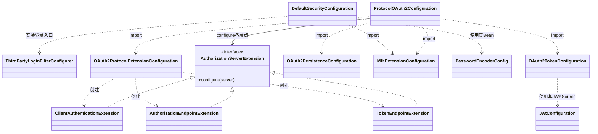
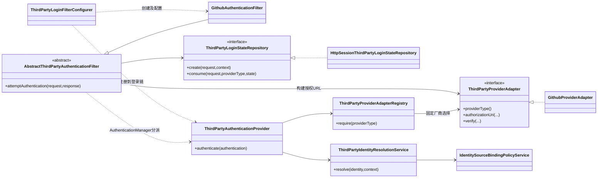
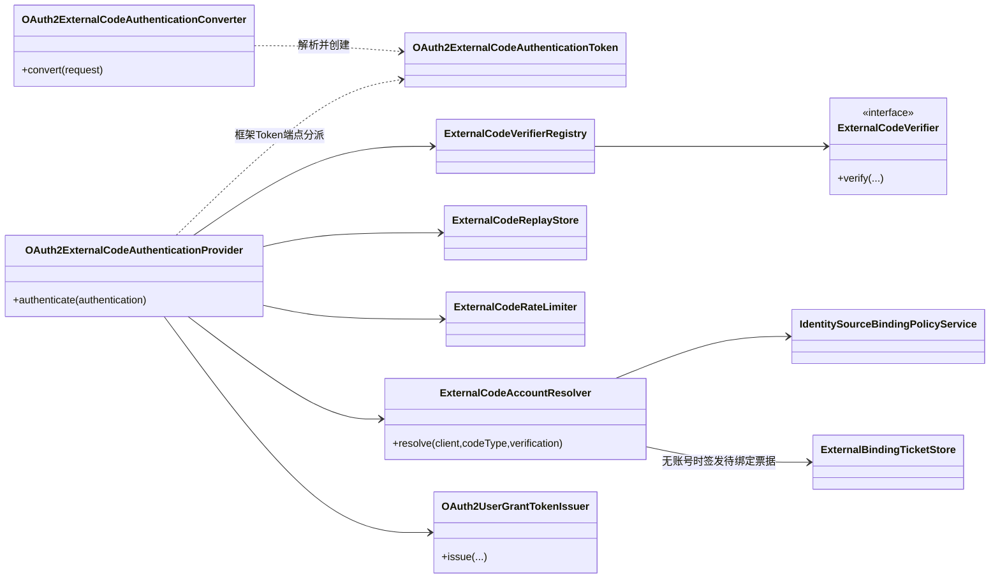
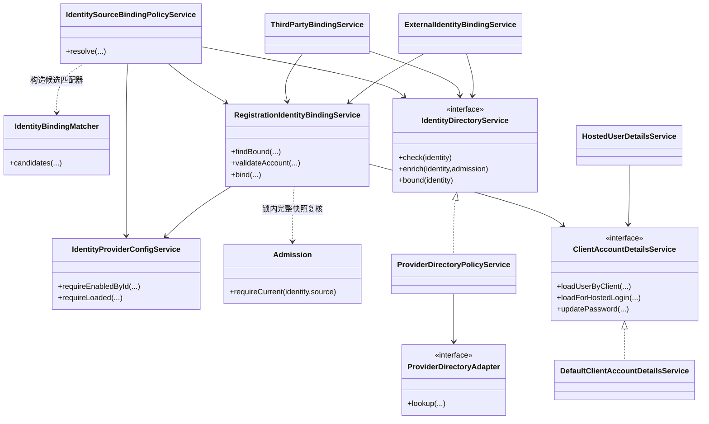
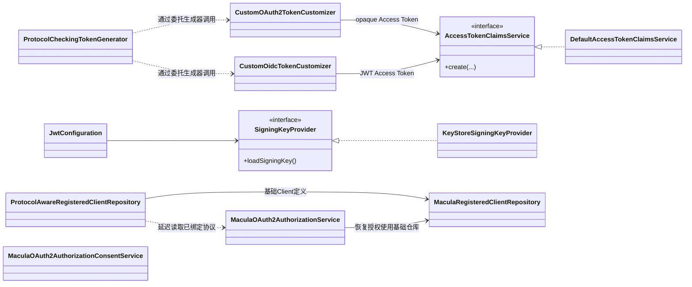
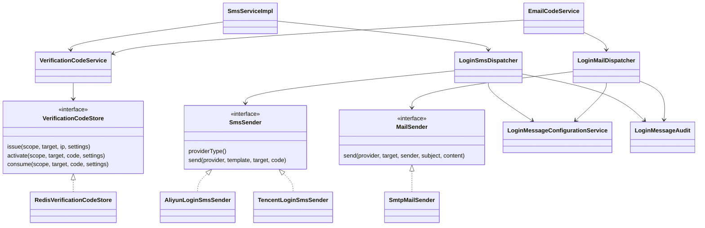

# IAM 类图与整体架构

本文依据当前源码说明主要类型、依赖和运行逻辑。[模块介绍](../README.md)面向接入者，[配置指南](configuration.md)
说明运行合同，[架构总览图](architecture.svg)用于快速定位边界。

## 1. 阅读模型

IAM 的核心是三件事：**核验身份、解析本地账号、发布协议结果**。

| 职责         | 回答的问题                                     | 归属                                                                 |
|--------------|------------------------------------------------|----------------------------------------------------------------------|
| 用户认证     | 当前凭据能否证明这个用户是谁？                 | authentication；平台Code认证适配在protocol/oauth2/grant/externalcode |
| 公共身份规则 | 该来源身份能否对应这个Client范围内的本地账号？ | service/account、service/client、service/identity                    |
| 协议发布     | 当前Client、协议和授权允许发布什么结果？       | protocol/oauth2                                                      |
| 装配         | 使用哪些实现、怎样组合安全链？                 | config/DefaultSecurityConfiguration、config/oauth2；根包为共用配置   |

登录配置和协议配置分别持有安全链。用户登录认证与OAuth Client认证也是两种身份：前者证明用户，后者证明调用Token端点的应用；
`none`只表示公共Client，不会替代用户凭据核验。

下列类图省略普通DTO、全部Mapper和框架内部调用。`A --> B`表示持有/依赖，`A ..> B`表示创建或调用依赖，`B <|.. A`表示A实现接口，
`B <|-- A`表示继承；框架分派用明确标注的依赖线表示，不冒充直接方法调用。

## 2. 配置与装配

- **DefaultSecurityConfiguration**：托管密码/SMS/EMAIL、五家第三方网页入口、Session、CSRF和受控请求恢复。
- **ProtocolOAuth2Configuration**：协议端点匹配、链优先级、CORS、协议失败响应及授权服务器组合。协议链优先匹配，其余请求才进入登录链。
- **三个Extension**：分别负责OAuth Client认证、授权端点、Token端点；原生标准grant仍交给框架。
- **JwtConfiguration**：只提供SigningKeyProvider、不可变JWKSource和JwtDecoder，不装配用户登录Provider或Filter。
- **MFA/密码编码器**：跨流程使用的配置留根包。MFA是发布前策略扩展，默认不增加因子要求。

配置类只组装对象。CORS规则位于`protocol.oauth2.endpoint.OAuth2CorsConfigurationSource`，声明算法、平台核验与绑定规则也各归其实现，不继续塞入配置类。

## 3. 第三方网页登录

图中以GitHub代表一组具体入口，其余为Wecom、Feishu、Dingtalk、Wechat对应的Filter和Adapter。五家均已接入统一Provider；各厂商Client仍分别处理实际HTTP协议，Registry拒绝重复厂商键。

运行逻辑：

1. 业务应用发起`/oauth2/authorize`，IAM保存受控授权请求；登录页按Client允许的方法展示入口。
2. Filter固定Client、registration、能力、来源版本及回调，创建一次性state，调用Adapter构建平台授权URL。
3. 回调消费state并复核当前配置，交给AuthenticationManager；统一Provider通过Adapter核验Code，取得`VerifiedExternalIdentity`。
4. ThirdPartyIdentityResolutionService核对网页登录上下文，调用公共身份策略。没有合法账号时进入pending绑定，不视为已登录。
5. 认证成功后经过发布策略建立Session，恢复授权请求；协议链继续校验授权及同意状态，发布授权码。业务应用凭授权码与原PKCE
   verifier换取Token。

Filter模板复用的是state、回调和请求恢复生命周期；Adapter复用的是稳定平台接口，厂商差异留在具体实现。没有让一个AbstractService同时负责平台网络、Session和Token签发。

## 4. 平台Code与external_code

运行逻辑：

1. Token端点先完成Client身份处理，再由Converter严格解析参数；重复、未知、越界或不适用参数拒绝。
2. Provider核对Client授权、Code能力、固定registration、Scope和来源合同；限流后占用Replay记录，再调用对应Verifier核验平台Code。
3. Resolver再次约束Client目录和核验结果，调用与网页登录相同的身份策略，得到本地用户。
4. 解析成功才交给TokenIssuer，经协议、版本及MFA发布检查生成Token；不创建浏览器SSO，不向公共Client签发Refresh Token。
5. 未绑定时返回`binding_required`与短期入口。用户完成账号证明后重新获取平台Code登录；绑定成功不直接复用原Code发Token。

只有明确未向平台提交Code时才允许释放Replay占用。超时、结果未知或已换码后的资料失败不能证明Code可安全重试。

## 5. 公共账号、来源与绑定

公共策略的执行顺序是：**目录准入 → 按当前registration查有效绑定 → 无绑定时按显式映射匹配 → 唯一合法账号才绑定**
。已有绑定不跳过目录准入；映射关闭、无候选或歧义不会自动创建/合并用户。

- **IdentitySourceBindingPolicyService**决定何时复用绑定、何时自动匹配。
- **RegistrationIdentityBindingService**复核Client范围、来源、账号状态与版本，维护稳定userId绑定；底层Mapper承担数据访问。
- **IdentityDirectoryService**是公共准入端口，携带有界有效期Admission。具体实现处理成员查询、资料快照和后台刷新；公共身份规则不依赖该实现类。
- **ClientAccountDetailsService**
  只接受显式Client/租户/用户类型快照，不读取当前HTTP请求。HostedUserDetailsService负责登录请求适配；协议或绑定无需借用浏览器请求来猜用户目录。

两种手动绑定共用事务规则，但有不同证明和结果：

| 编排                           | 输入及证明                                                 | 完成结果                                                      |
|--------------------------------|------------------------------------------------------------|---------------------------------------------------------------|
| ThirdPartyBindingService       | 浏览器pending或SDK票据转入的页面；密码、绑定短信、合格会话 | 普通网页路径可继续登录；SDK路径只完成关系绑定，应用重新取Code |
| ExternalIdentityBindingService | opaque ticket与同Client的授权码Access Token                | 无Session绑定；不能用待绑定external_code自证本地账号          |

外部目录请求在数据库事务外执行；绑定在锁内复核来源和可信快照。事务提交后才消费pending/票据，回滚不提前清除证明。

## 6. Token、密钥与授权存储

JWT和opaque两种Access Token共用最小声明规则；OIDC ID Token的用户资料、nonce等仍由Oidc
Customizer单独处理。TokenGenerator外层保留当前协议、资源许可和MFA发布检查。签名密钥通过端口加载一次形成不可变JWK快照，JwtDecoder继续使用框架校验。

基础RegisteredClient仓库不读取请求、不反向查授权。请求视图仓库按当前请求或已保存的协议绑定收窄能力；它是Primary，但授权存储恢复明确使用基础仓库，避免拿请求状态解释历史记录。

授权和同意记录保存在Redis，Client/账号/来源/绑定配置由MySQL支撑。MaculaOAuth2AuthorizationService继续负责原授权索引、TTL、原子更新、版本与撤销；图中Consent服务作为独立框架存储适配列出，与Authorization服务没有虚构的直接调用关系。

## 7. 边界与现状判断

1. **平台身份不是本地账号**：只有服务端核验结果进入公共解析，不能把前端资料、普通展示邮箱或任意registration当作账号归属证明。
2. **登录成功不是随处发Token**：Session属于登录链，授权码/Token属于协议链；绑定完成与结果发布分离。
3. **共享算法不等于通用服务**：Claims虽然被JWT和opaque共用，仍解释RegisteredClient、grant和Scope，应归协议；Client配置和账号规则才是跨链应用服务。
4. **接口服务于替换和边界**：平台适配、目录准入、账号目录、登录状态、签名来源及Claims有明确契约；没有为每个类套接口，也没有用常量接口充当扩展点。
5. **兼容位置不是职责归属**
   ：SysUserDetails及第三方已持久化身份/状态类型保留原包名，避免改变旧Session/授权类型标识。新实现进入职责子包，详见[兼容类型说明](../src/main/java/dev/macula/cloud/iam/authentication/thirdparty/README.md)。

当前是按认证流程和协议边界组织的模块化分层，并非完整的六边形架构：公共服务实现仍直接使用Mapper，授权存储仍集中处理编码与Redis原子操作。这些是后续可独立评估的边界，不应为了类图整齐而在本轮重写持久化、改变安全合同或增加无行为转发层。

## 验证码与消息投递

邮箱和短信都属于托管认证，不属于 Token grant。Filter/Provider 处理各自凭据，统一交给 `ClientAccountDetailsService` 加载账号；
`HostedUserDetailsService` 只将受信请求上下文适配为显式参数。

`authentication/verification` 负责验证码安全生命周期：申请额度、投递回调、成功后激活、一次性消费。Scope 明确通道、用途和
Client；Redis 保留原 SMS 键和摘要，EMAIL 使用独立 `email-login` 命名空间，不能消费退役 email grant 的遗留记录。

`message/sms`、`message/mail` 提供真实投递端口，`template` 只读取服务端渠道与模板，`audit`
记录脱敏提交结果。采用组合、策略注册和适配器，避免用抽象父类强行统一邮件正文与短信供应商模板。投递成功仅代表已提交，不等于收件人收到。

邮箱成功认证记录框架 OTT 因子的真实时间，供 OIDC `auth_time` 使用；框架因子不进入业务权限声明，也不代表完成 MFA。会话发布仍调用
`MfaCompletionPolicy`，拒绝时不留下 SecurityContext。
